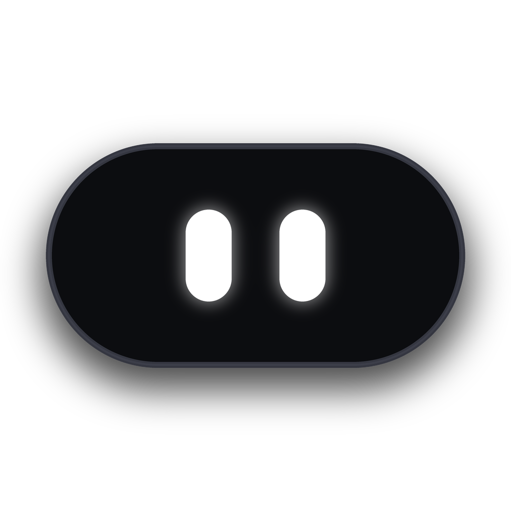

<div align="center">

  

  # ⚡ NOVASMART
  ### *Smart Dynamic Island & AI Companion for Windows 10 & 11*

  <p align="center">
    <strong>A next-generation Apple-inspired Dynamic Island, multi-model Free AI Assistant, SMTC media controls, per-app volume mixer, custom .exe launcher, and focus suite for Windows.</strong>
  </p>

  <p align="center">
    <a href="https://github.com/mehdi138iimm/NovaSmart/releases/latest">
      
    </a>
    <a href="https://github.com/mehdi138iimm/NovaSmart/stargazers">
      
    </a>
    <a href="https://github.com/mehdi138iimm/NovaSmart/blob/main/LICENSE">
      
    </a>
    <a href="https://tauri.app">
      
    </a>
    <a href="https://daramet.com/novasmart">
      
    </a>
  </p>

  <p align="center">
    <a href="#-key-features">Key Features</a> •
    <a href="#-live-web-preview">Live Web Demo</a> •
    <a href="#-quick-download--installation">Download</a> •
    <a href="#-developer-setup">Developer Guide</a> •
    <a href="#-architecture">Architecture</a> •
    <a href="#-fa-پشتیبانی-فارسی">فارسی</a>
  </p>

  <hr style="border: 0; height: 1px; background: rgba(255,255,255,0.1); margin: 30px 0;" />
</div>

---

## 🌟 Overview

**NOVASMART** elevates your Windows desktop workflow by introducing an intelligent, ultra-fluid **Dynamic Island** at the top of your screen. Built natively with **Tauri 2, Rust, React 19, and TypeScript**, it delivers zero-latency desktop productivity with virtually no RAM footprint (~20 MB).

Whether you need instant AI answers, seamless media playback controls, a per-application volume mixer, or quick .exe app launches — everything is accessible in **1 click** right from your screen notch.

---

## ✨ Key Features

<table>
  <tr>
    <td width="50%">
      <h3>🤖 100% Free AI Hub</h3>
      <p>Instant access to <strong>OpenAI GPT-4o, DeepSeek-V3, Qwen 2.5, Mistral Nemo</strong>, and <strong>Llama 3.3</strong> with zero fees and no API keys required. Full support for offline local <strong>Ollama</strong> instances and custom API keys.</p>
    </td>
    <td width="50%">
      <h3>🎵 Media & Volume Mixer</h3>
      <p>Synchronized Windows SMTC integration for <strong>Spotify, Chrome, Firefox, and Media Players</strong>. View live album art, track scrubbers, and adjust volume for individual Windows applications on the fly.</p>
    </td>
  </tr>
  <tr>
    <td width="50%">
      <h3>🚀 Custom .exe App Launcher</h3>
      <p>Drag & drop any Windows executable (<code>.exe</code>), game shortcut (<code>.lnk</code>), or batch script directly onto the notch for lightning-fast one-click execution.</p>
    </td>
    <td width="50%">
      <h3>⏱️ Deep Focus & Pomodoro</h3>
      <p>Customizable work/break cycles accompanied by peaceful <strong>Tibetan Singing Bowl</strong> synthesized audio chimes for mindful productivity.</p>
    </td>
  </tr>
  <tr>
    <td width="50%">
      <h3>📋 Encrypted Clipboard & File Shelf</h3>
      <p>100% local, encrypted clipboard history with smart regex filtering that safeguards passwords and credit cards. Drag & drop file shelf for rapid temporary staging.</p>
    </td>
    <td width="50%">
      <h3>👁️ Interactive Eye Notch Avatar</h3>
      <p>An animated, living notch with 9 expressive moods (<em>Idle, Thinking, Working, Attention, Success, Error, Sleep, Curious</em>), mouse tracking, and smooth blinking reactions.</p>
    </td>
  </tr>
</table>

---

## 🌐 Live Web Preview

Experience NOVASMART right in your browser without installing anything:

👉 **[Launch Live Web App Preview](https://mehdi138iimm.github.io/NovaSmart/)** *(or open `novasmart-website.html` / `site/index.html` locally)*

---

## 📥 Quick Download & Installation

### Option 1: Official Windows Installer (Recommended)
1. Go to the [**Releases Page**](https://github.com/mehdi138iimm/NovaSmart/releases/latest).
2. Download the latest `NOVASMART_Setup_x64.exe` (or `.msi`).
3. Run the installer and launch NOVASMART. The notch will smoothly dock at the top-centre of your primary monitor!

### Option 2: Run via Winget (Coming Soon)
```bash
winget install NovaSmart
```

---

## 🛠️ Developer Setup

Follow these steps to build and run NOVASMART from source:

### Prerequisites
- **Node.js**: v20.x or higher
- **Rust & Cargo**: Latest stable toolchain (`rustup`)
- **C++ Build Tools**: *Microsoft C++ Build Tools* or Visual Studio 2022
- **WebView2 Runtime**: (Pre-installed on Windows 10/11)

### Setup Commands

```bash
# 1. Clone the repository
git clone https://github.com/mehdi138iimm/NovaSmart.git
cd NovaSmart

# 2. Install dependencies
npm install

# 3a. Run in Browser Preview mode (Quick UI Development)
npm run dev

# 3b. Run Native Desktop App with Hot Reload (Tauri + Rust)
npm run tauri dev

# 4. Build Production Desktop Installer (.exe & .msi)
npm run tauri build
```

---

## 🏗️ Architecture & Project Structure

NOVASMART combines high-performance Rust native APIs with a modern React 19 interface:

```
NOVASMART/
├── src/                          # Frontend React 19 + TypeScript
│   ├── components/
│   │   ├── island/              # Dynamic Island notch & capsule containers
│   │   ├── eyes/                # Animated eye tracker & mood synthesis
│   │   ├── navigation/          # Floating dock tabs & pill indicators
│   │   └── ui/                  # Glassmorphic UI cards, buttons, & toggles
│   ├── features/
│   │   ├── ai/                  # Multi-provider AI chat & speech recognition
│   │   ├── music/               # Windows SMTC audio bridge & volume mixer
│   │   ├── focus/               # Pomodoro timer & Web Audio chimes synthesizer
│   │   ├── apps/                # Custom .exe launcher & shortcuts registry
│   │   ├── clipboard/           # Encrypted clipboard history & sensitive filter
│   │   ├── files/               # Drag & drop shelf
│   │   └── settings/            # Multi-monitor placement, themes, & preferences
│   ├── stores/                  # Zustand state stores (persisted & volatile)
│   └── i18n/                    # Bilingual translations (Persian / English)
│
├── src-tauri/                    # Native Rust Engine (Tauri v2)
│   ├── src/
│   │   ├── lib.rs               # Window management & DPI positioning logic
│   │   ├── media.rs             # Windows SMTC media hooks & audio session manager
│   │   ├── system.rs            # CPU / RAM / Battery hardware sensors
│   │   └── bridge.rs            # Local IPC loopback bridge for agent hooks
│   └── tauri.conf.json          # Tauri configuration & capabilities
│
└── site/                         # Landing page & standalone web showcase
    ├── index.html               # Ultra-modern showcase website
    └── app.html                 # Bundled standalone single-file web app
```

---

## ⌨️ Shortcuts & Interaction Modes

| Interaction | Trigger | Behavior |
|-------------|---------|----------|
| **Open Island** | `Hover` or `Click` on Notch | Expands into the full interactive panel |
| **Pin Panel** | `Click` while hovered | Locks the panel open until dismissed |
| **Quick Close** | `Escape` or click outside | Smoothly folds back into the minimalist notch |
| **Switch Tabs** | Click Dock Icons or `1-9` | Instantly transitions between AI, Music, Focus, etc. |

---

## 🇮🇷 (FA) پشتیبانی کامل از زبان فارسی

نوااسمارت (NOVASMART) با افتخار دارای **پشتیبانی کامل و بومی از زبان فارسی** همراه با چیدمان راست‌به‌چپ (RTL) و فونت چشم‌نواز **وزیرمتن (Vazirmatn)** است:

- 🧠 **هوش مصنوعی رایگان:** دسترسی بدون تحریم و بدون نیاز به API Key به مدل‌های DeepSeek، GPT-4o و Qwen.
- 🎚️ **میکسر صدای هر برنامه:** کنترل صدای تک‌تک نرم‌افزارهای در حال اجرا در ویندوز.
- 🚀 **لانچر فایل‌های exe:** اجرای سریع برنامه‌ها و بازی‌ها با کشیدن و رها کردن (Drag & Drop).
- 🧘 **تایمر تمرکز پومودورو:** همراه با نوای زنگ کاسه تبتی برای استراحت و افزایش تمرکز کاری.
- 🔒 **کلیپ‌بورد امن و محلی:** عدم ذخیره پسوردها و شماره کارت‌ها با پردازش کاملاً آفلاین.

---

## 💖 Support & Sponsoring

NOVASMART is 100% free and open-source. If you find it helpful and want to support its active development:

- ☕ **[Donate via Daramet (حمایت مالی)](https://daramet.com/novasmart)**
- ⭐ **Star this repository** to help more people discover it!
- 🐛 **Report bugs or request features** in the [Issues tab](https://github.com/mehdi138iimm/NovaSmart/issues).

---

## 📄 License

This project is licensed under the **MIT License** — see the [LICENSE](LICENSE) file for details.

<div align="center">
  <sub>Crafted with ❤️ by <a href="https://github.com/mehdi138iimm">Mehdi</a> for Windows power users worldwide.</sub>
</div>
